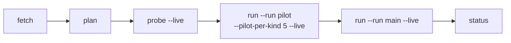

# Reproducing the study

Requires Go 1.27+. Commands run from the repository root.



```sh
go build -o order-blind .
./order-blind fetch    # download RewardBench 2 at the pinned revision; verifies SHA-256
./order-blind plan     # rebuild frozen/v1; must reproduce the committed SHA256SUMS exactly
./order-blind probe --live                                  # truncation probe (runs/probe/)
./order-blind run --run pilot --pilot-per-kind 5 --live     # pilot (runs/pilot/)
./order-blind run --run main --live                         # full run (runs/main/)
./order-blind status   # spend and progress across all runs
```

- **No `--live`, no calls.** Without `--live`, `probe` and `run` only print what they would send.
- **Body checks.** Before any call, every body is rebuilt and checked against the frozen `body_sha256`.
- **Budget.** `--budget` (default $100) caps spend across **all** receipts in `runs/`, not one invocation. Calls whose usage is unknown are reserved and charged at an estimate.
- **Resume.** Re-running a command skips requests that already have a successful receipt in that run.
- **Retries.** Up to four attempts per request, retrying 429, 408, 5xx, network errors and unparseable responses. Every attempt gets its own receipt.

## Credentials

| Provider | Route | Needs |
|---|---|---|
| Jev 1.13 (`jev`) | `https://typesafe.int.exe.xyz/v1/systemone` | an exe.dev `typesafe` integration (injects the key) |
| Jev 1.14 (`jev114`) | same as Jev 1.13; sends the pinned model `jev-1.14.0` and rejects answers from any other model | an exe.dev `typesafe` integration |
| OpenAI Decisions | `https://openai.int.exe.xyz/v1/decisions` | an exe.dev `openai` integration |
| Clef-flash | Cloudflare Workers AI REST API | `CLOUDFLARE_ACCOUNT_ID` and `CLOUDFLARE_API_TOKEN` (Workers AI Read is enough) |
| Microsoft-Decision-1 (`msd1`) | OpenRouter decisions API, `https://openrouter.int.exe.xyz/api/alpha/decisions` | an exe.dev `openrouter` integration (injects the key); off exe.dev, `https://openrouter.ai/api/alpha/decisions` with an OpenRouter key |
| SubQ Snap (`subq`) | `https://subq.int.exe.xyz/v1/systemone` | an exe.dev `subq` integration; off exe.dev, set `SUBQ_URL=https://api.subq.ai/v1/systemone` and `SUBQ_API_KEY` in the environment |
| [Rune](https://fireworks.ai/models/fireworks/rune) (Fireworks System One, `accounts/fireworks/routers/rune`) (`rune`) | `https://fireworks.int.exe.xyz/inference/v1/systemone` | an exe.dev `fireworks` integration (injects the key); off exe.dev, point `runeRoute` in `provider.go` at `https://api.fireworks.ai/inference/v1/systemone` and supply a Fireworks key |

Off exe.dev, point the provider URLs in [`internal/provider/provider.go`](../internal/provider/provider.go) at the direct APIs and supply keys.

SubQ Snap's [published list price](https://docs.subq.ai/using-the-api/models/) is $0.05 per million input tokens, with output free. `SUBQ_USD_PER_MTOK_INPUT` can pin an attributable override. The main run uses the public RewardBench 2 plan. SubQ's documented default is indefinite prompt/completion retention, so do not reuse this route for private data without confirming the account policy.

Rune's accounting rate is $0.042 per million input tokens with output free, the same as Jev; costs are list-price estimates, not invoices. The `rune` provider sends Jev's body with only `model` changed to `accounts/fireworks/routers/rune`, rejects an answer from any other model, and records HTTP 400 "exceeds limit 16384" as a non-retryable failure. It runs the same gates against the same frozen plan:

```bash
./order-blind run --run pilot --pilot-per-kind 5 --providers rune --workers 4 --budget 15 --live
./order-blind run --run main --providers rune --workers 4 --budget 15 --live
```

The SubQ provider uses the same sequential gates and frozen plan:

```bash
export SUBQ_URL=https://api.subq.ai/v1/systemone
export SUBQ_API_KEY=... # environment only; never committed
./order-blind probe --providers subq --provider-workers subq=4 --budget 250 --live
./order-blind run --run pilot --pilot-per-kind 5 --providers subq --provider-workers subq=4 --budget 250 --live
./order-blind run --run main --providers subq --provider-workers subq=4 --budget 250 --live
```

Jev 1.14 runs the same gates against the same frozen plan. The `jev114` provider swaps only the body's `model` field to `jev-1.14.0`; each receipt records both the frozen `body_sha256` and the `sent_sha256` of the bytes actually sent:

```bash
./order-blind probe --providers jev114 --live
./order-blind run --run pilot --pilot-per-kind 5 --providers jev114 --provider-workers jev114=4 --live
./order-blind run --run main --providers jev114 --provider-workers jev114=8 --live
```
