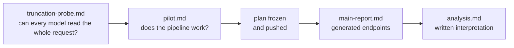

# Results

Every result in this folder is computed from the committed receipts in [`../runs/`](../runs/). Rebuild the database with `./order-blind import` and regenerate the report with `./order-blind report`. The gates ran in this order:

| Document | What it is | Headline |
|---|---|---|
| [`analysis.md`](analysis.md) | **Start here.** Written analysis of the main run, with charts and caveats | Jev is order-blind. OpenAI Decisions and SubQ Snap favor the first response (+6.1 and +7.0 pp); Microsoft-Decision-1 disfavors the last (−4.5 pp). Clef-flash is inconclusive. |
| [`main-report.md`](main-report.md) | Generated report: every preregistered and secondary endpoint for all 76,200 requests per model (five models), with 90% bootstrap intervals | Primary endpoints, paired differences from Jev, question-order arm, consistency, ties, planted-bias check, per-subset results, refusals, cost and latency |
| [`pilot.md`](pilot.md) | Pilot on 35 seeded items (1,400 requests per model) | Every provider passed. SubQ: 1,400/1,400, no refusals or invalid answers, $0.1005 estimated list-price cost. |
| [`truncation-probe.md`](truncation-probe.md) | Needle-at-start/end probe of how much request text each model reads | No truncation up to about 9,700 reported tokens for any model, SubQ included, so no v1 request was cut short. |

Raw receipts: [`../runs/probe/`](../runs/probe/), [`../runs/pilot/`](../runs/pilot/), [`../runs/main/`](../runs/main/). The frozen plan is in [`../frozen/v1/`](../frozen/v1/) and the design in [`../plans/v1-design.md`](../plans/v1-design.md).
