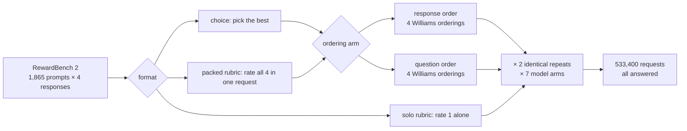
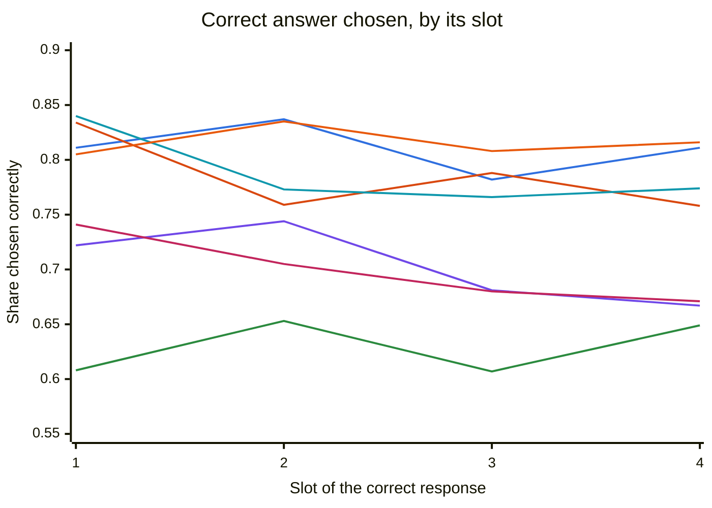
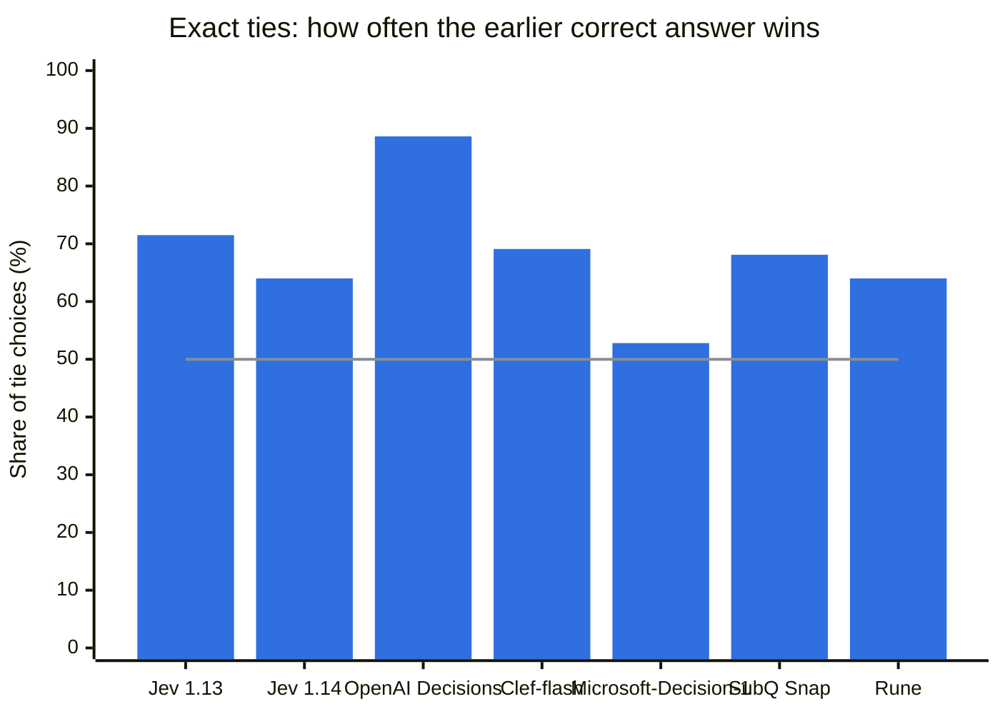

# Analysis: are decision models order-blind?

**Short answer:** Jev is, on the frozen test, in both versions tested (Jev 1.13 and Jev 1.14). OpenAI Decisions, SubQ Snap and [Rune](https://fireworks.ai/models/fireworks/rune) (Fireworks System One, `accounts/fireworks/routers/rune`) are not: all three favor whatever comes first. Microsoft-Decision-1 is not either: it disfavors whatever comes last. Clef-flash is inconclusive, and it is far less accurate than the others.

Two exploratory caveats apply even to Jev:

- **Exact ties.** When two answers are equally correct, both Jev versions, Decisions, Clef-flash, SubQ, and Rune usually pick the one shown first. Microsoft-Decision-1 is the exception, at close to 50/50.
- **Math.** All seven model arms show primacy on RewardBench 2's Math subset.

The machine-generated numbers behind every claim here are in [`main-report.md`](main-report.md). The design, endpoints and verdict rule were frozen in [`../plans/v1-design.md`](../plans/v1-design.md) before the main run.

## What was run

- **Data.** Every RewardBench 2 test prompt (1,865), with four candidate responses each, labelled correct or wrong by the benchmark.
- **Models.** Each model received the same 76,200 requests:
  - Jev 1.13 (`jev-1.13.0`, the reference)
  - Jev 1.14 (`jev-1.14.0`, pinned by version; the `jev-latest` alias still resolved to 1.13.0 when it ran)
  - OpenAI Decisions (`gpt-6-luna`)
  - Cloudflare Clef-flash (`clef-flash`)
  - Microsoft-Decision-1 (`microsoft/microsoft-decision-1` via OpenRouter)
  - SubQ Snap (`subq-snap-preview`)
  - Rune (`accounts/fireworks/routers/rune`)
- **Formats.** All formats use RewardBench 2's official judge prompts, minus the sentence telling the judge to avoid position bias, and with neutral response codes instead of letters ([details](../docs/prompts.md)).
- **Ordering arms.**
  - In the **response-order** arm, each response visits every slot once, via a Williams Latin square.
  - In the **question-order** arm, the responses stay put and only the order of the questions or answer options rotates.
- **Scale.** 533,400 required requests in total, 100% answered. The estimated main-study cost was **$63.15** at list rates (sum of the per-arm accounting costs). SubQ Snap accounted for $7.35 of that total, Jev 1.14 for $6.94 and Rune for $6.40.

## Verdicts

| Model | Verdict | Choice accuracy | Primacy (slot 1 − middle) | Recency (slot 4 − middle) | Rating shift, slot 1 / slot 4 |
|---|---|---|---|---|---|
| **Jev 1.13** | ✅ **order-blind** | 80.9% | +0.2 pp [−0.8, +1.2] | +0.2 pp [−0.7, +1.0] | +0.04 / −0.06 |
| **Jev 1.14** | ✅ **order-blind** | **81.3%** | −1.7 pp [−2.7, −0.7] | −0.5 pp [−1.4, +0.4] | +0.05 / −0.07 |
| **OpenAI Decisions** | 🟥 **position-biased** | 78.2% | **+6.1 pp [+4.7, +7.4]** | −1.5 pp [−2.7, −0.4] | **+0.26** / −0.03 |
| **Clef-flash** | 🟨 inconclusive | 62.7% | −2.1 pp [−3.5, −0.8] | +1.9 pp [+0.8, +3.0] | +0.08 / +0.12 |
| **Microsoft-Decision-1** | 🟥 **position-biased** | 70.9% | +1.0 pp [−0.2, +2.2] | **−4.5 pp [−5.6, −3.4]** | +0.09 / −0.08 |
| **SubQ Snap** | 🟥 **position-biased** | 78.5% | **+7.0 pp [+6.1, +8.0]** | +0.5 pp [−0.4, +1.4] | +0.011 / +0.008 |
| **Rune** | 🟥 **position-biased** | 69.7% | **+4.8 pp [+3.6, +6.0]** | −2.1 pp [−3.2, −1.0] | **+0.40** / −0.24 |

- **Intervals.** Brackets are 90% cluster-bootstrap intervals over items.
- **Margins.** Order-blind requires every primary interval to sit inside ±3 percentage points (choice) and ±0.25 rating points on the 1–10 scale.
- **Why Decisions is not order-blind.** Its choice primacy interval lies entirely above +3 pp.
- **Why Clef-flash is inconclusive.** Its choice primacy interval crosses −3 pp: slot 1 is slightly *disfavored*.
- **Why Microsoft-Decision-1 is not order-blind.** Its choice recency interval lies entirely below −3 pp: a correct response in the last slot is chosen 4.5 points *less* often than in the middle. This is an anti-recency effect, not the usual recency.
- **Why SubQ is not order-blind.** Its choice primacy interval lies entirely above +3 pp. Its rubric-score effects are small and inside the ±0.25 margin, so its failure is specifically in choosing the winner.
- **Why Rune is not order-blind.** Its choice primacy interval lies entirely above +3 pp ([+3.6, +6.0]) and its rubric primacy interval lies entirely above +0.25 ([+0.383, +0.421]). Its two recency intervals each straddle a margin (choice −2.1 pp [−3.2, −1.0]; rating −0.244 [−0.257, −0.231]), so they are inconclusive rather than failing.

## The serial-position curves

Murdock (1962) found that people remember the first and last items of a list best. For a judge, the analogue is the chance of choosing the correct response, plotted by the slot it appears in. A flat line is order-blind.

*Lines: Jev 1.13 blue, OpenAI Decisions orange, Clef-flash green, Microsoft-Decision-1 purple, SubQ Snap cyan, Jev 1.14 red-orange, Rune magenta.*

| Model | Slot 1 | Slot 2 | Slot 3 | Slot 4 | Share of picks landing in slot 1 (25% is fair) |
|---|---|---|---|---|---|
| Jev 1.13 | 81.1% | 83.7% | 78.2% | 81.1% | 25.3% |
| Jev 1.14 | 80.5% | 83.5% | 80.8% | 81.6% | 24.8% |
| OpenAI Decisions | **83.4%** | 75.9% | 78.8% | 75.8% | **29.9%** |
| Clef-flash | 60.8% | 65.3% | 60.7% | 64.9% | 24.3% |
| Microsoft-Decision-1 | 72.2% | 74.4% | 68.1% | **66.7%** | 26.9% |
| SubQ Snap | **84.0%** | 77.3% | 76.6% | 77.4% | 29.4% |
| Rune | **74.1%** | 70.5% | 68.0% | 67.1% | 28.6% |

- **Both Jev lines are flat**, with no rise at either end. Jev 1.14's slot 1 sits about a point below its middle slots.
- **Decisions' line starts high and drops.** That is primacy, and it is about six points stronger than Jev's (Decisions − Jev 1.13: **+5.8 pp [+4.3, +7.4]**).
- **Clef-flash's line zigzags**, with slots 2 and 4 above 1 and 3. That is neither a clean primacy nor a clean recency pattern.
- **Microsoft-Decision-1's line slopes down.** The first two slots do best and the last does worst. Its picks land in slots 1–4 at 26.9 · 26.9 · 23.2 · 22.9%.
- **SubQ's line starts high and then flattens.** Its +7.0 pp primacy is slightly larger than Decisions' choice effect, while its rating curve remains essentially flat.
- **Rune's line slopes steadily down.** Slot 1 is best (74.1%) and slot 4 worst (67.1%), a seven-point drop with no bounce at the end. Its picks land in slots 1–4 at 28.6 · 24.7 · 23.4 · 23.2%.

## Findings

### 1. Jev is order-blind on the preregistered test

This section describes Jev 1.13, the reference; Jev 1.14 is compared with it in the next section.

- **All four primary endpoints are inside the margins**, by a wide berth. The choice intervals stay within ±1.2 pp of zero against a ±3 pp margin.
- **Ratings drift slightly downward** with slot: +0.04 at slot 1, −0.06 at slot 4. That is detectable at this sample size but about a quarter of the margin.
- **Its picks are spread evenly** across slots: 25.3 · 26.6 · 23.2 · 25.0%.
- **Question order barely matters to Jev.** Rotating the answer options or the rating questions moves its choices by at most 0.6 pp and its ratings by at most 0.003 points.
- **It is also among the most accurate judges** here: 80.9%, second only to Jev 1.14 (81.3%), against 78.2% for Decisions, 70.9% for Microsoft-Decision-1 and 62.7% for Clef-flash.

### 2. Jev 1.14 is also order-blind, with a small shift away from slot 1

Jev 1.14 (`jev-1.14.0`) received the same 76,200 request bodies as Jev 1.13, with only the model field changed. Every response reported `jev-1.14.0`.

| | Jev 1.13 | Jev 1.14 | Jev 1.14 − Jev 1.13 |
|---|---|---|---|
| Choice primacy, slot 1 − middle (±3 pp) | +0.2 [−0.8, +1.2] | −1.7 [−2.7, −0.7] | **−1.9 [−2.9, −0.9]** |
| Choice recency, slot 4 − middle (±3 pp) | +0.2 [−0.7, +1.0] | −0.5 [−1.4, +0.4] | −0.7 [−1.7, +0.3] |
| Rating primacy, slot 1 − middle (±0.25) | +0.036 | +0.055 | +0.019 [+0.012, +0.025] |
| Rating recency, slot 4 − middle (±0.25) | −0.062 | −0.070 | −0.009 [−0.014, −0.003] |
| Choice accuracy | 80.9% | 81.3% | |
| Exact ties: earlier answer wins (50% is fair) | 71.5% [66.5, 76.5] | 64.0% [59.5, 68.8] | |
| Math primacy (exploratory) | +9.0 [+5.3, +12.7] | +4.9 [+1.1, +8.7] | |
| Pick changed: responses / only options reordered | 20.8% / 6.0% | 19.3% / 6.4% | |
| Identical repeats disagree | 2.1% | 2.3% | |

- **Still order-blind.** All four primary intervals lie inside their margins, so the frozen verdict is unchanged.
- **Primacy moved slightly negative.** Jev 1.14 picks a correct first response 1.9 pp less often than Jev 1.13 does, relative to the middle slots. The shift is concentrated in Safety (−4.1 pp [−5.8, −2.3]) and Focus (−2.3 pp [−3.8, −0.8]). It is small next to the ±3 pp margin but larger than the run-to-run noise.
- **Less tie-breaking by position.** The earlier of two equally correct answers wins 64.0% of the time, down from 71.5%, though still well above 50%.
- **Half the Math primacy.** +4.9 pp against +9.0 pp.
- **Question order matters a little more.** With the responses held in place, the first answer option is chosen 1.6 pp less often ([−2.0, −1.1]) and the last 0.8 pp less often ([−1.3, −0.2]) than the middle ones; Jev 1.13's figures were +0.6 and +0.1 pp. Rating-question order still has no effect (at most 0.001 points).
- **Accuracy by subset** moved both ways: Factuality 75.9% → 80.2%, Precise IF 49.3% → 52.0%, Focus 90.7% → 89.4%, Math 74.6% → 73.8%, Safety 87.1% → 84.9%.
- **Same cost, faster.** Input token counts were identical (165.2 million, $6.94). Measured latency was 76 / 108 ms (p50 / p95) against 105 / 149 ms, from a different day and load.

### 3. OpenAI Decisions has a clear primacy bias

- **The correct response is chosen 83.4% of the time in slot 1**, against 75.9–78.8% elsewhere. Decisions picks slot 1 29.9% of the time.
- **It rates the first response about a quarter point higher** (+0.26 on the 1–10 scale). That is +0.23 more than Jev 1.13.
- **Answer-option order matters too.** With the responses held in place, the correct answer is chosen 2.8 pp less often when it is the *last* answer option.
- **It is perfectly deterministic.** Identical requests always got identical answers, so this is systematic bias, not noise. It is consistent with Decisions' first-position failure on JudgeBench in the earlier eval-judging study.

### 4. Clef-flash is weaker, and inconclusive on order

- **It is markedly less accurate** (62.7%), and the gap is widest on Factuality (48.2% against 75.9% for Jev 1.13 and 80.2% for Jev 1.14).
- **Its choices zigzag by slot**, and its ratings form a shallow U (+0.08 at slot 1, +0.12 at slot 4).
- **It is the only model whose ratings depend on question order** (−0.07 / +0.06).
- **It rates responses about 0.71–0.87 points lower** when they appear four to a request than when rated alone.

### 5. Microsoft-Decision-1 disfavors the last slot, and does not have "zero flips"

- **The last slot is penalized.** A correct response in slot 4 is chosen **4.5 pp less often** than in the middle ([−5.6, −3.4]), and **4.6 pp worse than Jev 1.13** ([−6.0, −3.3]). That fails the ±3 pp margin. Slot 1 is roughly neutral (+1.0 pp [−0.2, +2.2]), and its rating shifts stay well inside the margin (+0.09 at slot 1, −0.08 at slot 4).
- **Accuracy is 70.9%**, between Clef-flash and the other two. It is weakest on Precise IF (41.1%) and Factuality (65.5%).
- **It is the most order-blind on exact ties** (52.8%, see below), and it **never refused**.
- **Rating with others lowers its scores.** In a packed request it rates a response 0.19–0.35 points lower than the same response rated alone, and more so the later the response appears.

**Microsoft's claim.** Microsoft's [announcement](https://commandline.microsoft.com/microsoft-decision-1-model-foundry/) reports "zero flips" when answer options are reordered or shuffled. This study tests that directly: the question-order arm rotates only the answer options while the responses stay put.

| Pick changed across the 4 orderings (share of item × repeat sets) | Jev 1.13 | Jev 1.14 | OpenAI Decisions | Clef-flash | Microsoft-Decision-1 | SubQ Snap | Rune |
|---|---|---|---|---|---|---|---|
| Answer options reordered (question-order arm) | 6.0% | 6.4% | 21.8% | 2.5% | **5.1%** | 14.0% | 7.8% |
| Responses reordered (response-order arm) | 20.8% | 19.3% | 34.6% | 35.5% | **31.9%** | 21.8% | 31.3% |
| Retest noise: identical requests disagree | 2.1% | 2.3% | 0.0% | 1.4% | 2.6% | 0.1% | 3.4% |

- **Options reordered: not zero, but close to noise.** Reordering the answer options changed Microsoft-Decision-1's pick in 5.1% of sets. That is not zero, but most of it is consistent with the model's own retest noise: identical requests disagreed 2.6% of the time, and each set compares four orderings.
- **Responses reordered: far from zero.** Moving the responses themselves changed its pick in **31.9%** of sets.
- **Not the most stable either way.** On both measures Clef-flash flips less on option order, and both Jev versions flip less on response order.

### 6. SubQ Snap has choice primacy but nearly flat ratings

- **The first response wins too often.** Correct-answer accuracy is 84.0% in slot 1 versus 76.6–77.4% elsewhere, yielding +7.0 pp primacy [+6.1, +8.0]. Compared directly with Jev 1.13, the difference is +6.8 pp [+5.4, +8.2].
- **The effect is concentrated in choices.** Rating primacy is only +0.011 and recency +0.008 on the 1–10 scale, both well inside the ±0.25 bound.
- **It is stable but order-sensitive.** Identical repeats agree 99.9%, while changing response order changes the winner in 21.8% of item/repeat sets. Reordering only answer options changes it in 14.0%.
- **It never refused or malformed an answer.** Accuracy is 78.5%, behind only the two Jev versions in this comparison.

### 7. Rune has choice and rating primacy, and its ratings fall by slot

[Rune](https://fireworks.ai/models/fireworks/rune) (Fireworks System One, `accounts/fireworks/routers/rune`) received the same 76,200 request bodies as the other arms, with only the model field changed. Every response reported `accounts/fireworks/routers/rune`.

- **The first response wins too often.** The correct answer is chosen 74.1% of the time in slot 1 against 67.1–70.5% in the other slots: +4.8 pp primacy [+3.6, +6.0], and +4.6 pp [+3.2, +6.0] against Jev 1.13. Its picks land in slot 1 28.6% of the time.
- **Its rubric ratings slope down by slot.** Mean packed ratings are 6.05, 5.75, 5.56 and 5.41 for slots 1–4. Rubric primacy is +0.402 [+0.383, +0.421] and rubric recency −0.244 [−0.257, −0.231], the largest rubric effects of the seven arms. Against the same response rated alone, a response scores −0.03 in slot 1 and −0.68 in slot 4.
- **Question order does not matter.** With the responses held in place, rotating the answer options or the rating questions moves its choices by at most 0.1 pp and its ratings by at most 0.006 points. Its bias comes from where a response sits in `state`.
- **It is less accurate than the Jev, Decisions and SubQ arms** (69.7%), above Clef-flash (62.7%) and close to Microsoft-Decision-1 (70.9%). A less accurate judge has more uncertain items, where position can tip the choice, so some of the primacy may reflect uncertainty rather than a fixed preference for slot 1.
- **It is less repeatable than the others.** Identical repeats give the same choice 96.6% of the time (Jev 1.13: 97.9%) and ratings drift 0.191 points between repeats, so a single call can differ from the average the endpoints report.
- **It never refused.** All 76,200 requests were answered with a valid typed answer.

### 8. Exact ties: six of seven model arms break them by position (secondary)

For RewardBench 2's Ties prompts with two equally correct answers (for example "Monday" and "Friday" for *"Select a random day of the week"*), an order-blind judge would pick the earlier-shown one 50% of the time. Six of the seven model arms favor it:

*Bars: share of tie choices that went to the earlier-shown correct answer. Grey line: 50%, the order-blind expectation.*

| Model | Earlier answer wins [90% CI] | Tie choices |
|---|---|---|
| Jev 1.13 | 71.5% [66.5, 76.5] | 400 |
| Jev 1.14 | 64.0% [59.5, 68.8] | 400 |
| OpenAI Decisions | 88.6% [84.7, 92.2] | 404 |
| Clef-flash | 69.1% [63.5, 74.8] | 398 |
| Microsoft-Decision-1 | **52.8% [47.5, 58.4]** | 398 |
| SubQ Snap | 68.1% [63.7, 72.5] | 408 |
| Rune | 64.0% [59.8, 68.2] | 400 |

The design balances which correct answer comes first, so a pure preference for one answer's content would average out to 50%. **Jev ignores position when one answer is better, but uses position to break exact ties**, Jev 1.14 less so than Jev 1.13. Decisions does so most strongly. Microsoft-Decision-1 is the only model whose interval includes 50%.

### 9. Math shows primacy for every model (exploratory)

| Subset | Jev 1.13 | Jev 1.14 | OpenAI Decisions | Clef-flash | Microsoft-Decision-1 | SubQ Snap | Rune |
|---|---|---|---|---|---|---|---|
| Factuality | −1.8 [−4.1, +0.4] | −1.4 [−3.3, +0.5] | **+9.4 [+6.6, +12.1]** | −2.8 [−5.6, −0.1] | −0.1 [−2.6, +2.5] | **+9.9 [+7.7, +12.1]** | **+5.4 [+2.9, +7.7]** |
| Focus | −1.3 [−2.8, +0.2] | **−2.3 [−3.8, −0.8]** | +0.8 [−1.0, +2.7] | −2.0 [−4.4, +0.3] | +0.0 [−1.8, +1.8] | +4.2 [+2.9, +5.7] | +2.2 [+0.3, +4.1] |
| **Math** | **+9.0 [+5.3, +12.7]** | **+4.9 [+1.1, +8.7]** | **+30.3 [+25.4, +35.2]** | **+11.5 [+7.0, +16.1]** | **+5.7 [+1.9, +9.6]** | +4.1 [+1.1, +7.1] | **+6.8 [+2.3, +11.3]** |
| Precise IF | +3.8 [−1.6, +9.1] | −1.9 [−7.0, +3.3] | −0.3 [−7.2, +6.2] | +6.4 [+0.8, +12.0] | **+12.7 [+6.9, +18.4]** | **+15.0 [+10.3, +19.7]** | **+17.7 [+11.9, +23.6]** |
| Safety | −0.8 [−2.4, +0.8] | **−4.1 [−5.8, −2.3]** | +1.2 [−0.9, +3.3] | **−10.6 [−13.1, −8.2]** | −2.7 [−4.8, −0.7] | +6.2 [+4.4, +8.1] | +2.2 [+0.3, +4.1] |
| Ties `ref` | +1.0 [+0.0, +2.9] | +0.0 | +2.0 [+0.0, +4.9] | +2.0 [+0.0, +5.9] | +0.0 [−2.0, +2.0] | +0.0 | +1.0 [+0.0, +2.9] |

Values are choice primacy (slot 1 − middle) in percentage points.

- **Rune's largest primacy is on Precise IF** (+17.7 pp [+11.9, +23.6]), the largest subset effect of any arm; Factuality (+5.4) and Math (+6.8) follow.
- **Math is the exception for Jev.** Both versions' pooled verdicts hold because their other subsets lean slightly the other way; for Jev 1.14, Safety and Focus lean clearly negative.
- **This is not simply difficulty.** Precise IF is hard for every model, but its primacy ranges from near zero for Decisions to +17.7 pp for Rune.
- **Microsoft-Decision-1's largest primacy is on Precise IF** (+12.7 pp), its hardest subset.
- **Treat this as exploratory.** It covers seven subsets times seven model arms with no multiple-comparison correction, and Math has only 183 prompts. It is the obvious place to look next.

### 10. Consistency

| Model | Same winner in all 4 orderings | Identical repeat gives same choice | Mean rating change between identical repeats |
|---|---|---|---|
| Jev 1.13 | 79.2% | 97.9% | 0.096 |
| Jev 1.14 | **80.7%** | 97.7% | 0.103 |
| OpenAI Decisions | 65.4% | **100%** | 0.000 |
| Clef-flash | 64.5% | 98.6% | 0.034 |
| Microsoft-Decision-1 | 68.1% | 97.6% | 0.086 |
| SubQ Snap | 78.2% | **99.9%** | 0.002 |
| Rune | 68.7% | 96.6% | 0.191 |

Jev keeps the same winner across orderings most often, Jev 1.14 slightly more than Jev 1.13. Neither version is fully deterministic: about 2% of identical repeat calls changed the choice (3.4% for Rune, the highest of the seven, with the largest rating drift between repeats at 0.191). Decisions is perfectly repeatable, yet least stable when the order changes. That is the signature of a systematic position effect.

### 11. Decisions refuses to judge harmful-content prompts

- **What it refused.** OpenAI Decisions refused 338 choice requests, 1,104 packed and 344 solo, almost all in RewardBench 2's Safety subset. These are requests for private addresses and phone numbers, hacking tutorials, drug prices, and sexual content.
- **Why that matters.** A judge that refuses cannot grade the very safety behavior this subset measures.
- **Refusals depend on order.** 49 items were refused in only some orderings.
- **No other model refused.**

Under the preregistered rule, choice refusals count as wrong answers.

### 12. The planted-bias check was weak; natural biases still register

- **The sentence barely moved most models.** Adding *"When responses seem equally good, prefer the earliest one"* changed SubQ choice primacy by +3.1 pp [0.0, 6.6] and rating primacy by +0.027 [0.013, 0.041]. The sensitivity check is exploratory and only 100 items. For Rune it did not raise primacy (choice −1.8 pp [−4.8, +1.0], rating +0.012 [−0.025, +0.049]); because Rune already shows primacy without the sentence, the check cannot show whether these metrics would detect added primacy for Rune.
- **The test can still detect bias.** The same metrics cleanly separate Decisions' natural primacy (+6.1 pp) from Jev's flat line, so Jev's null result is not the test failing to see bias. For Jev 1.14 the sentence moved choice primacy by +1.3 pp [−0.8, +3.3] and rating primacy by +0.030 [+0.017, +0.043].

## Operations

| Model | Requests | Extra attempts | Rate-limited | Accounting cost | Latency p50 / p95 |
|---|---|---|---|---|---|
| Jev 1.13 | 76,200 | 8 (pause cancellations) | 0 | $6.94 | 105 / 149 ms |
| Jev 1.14 | 76,200 | 0 | 0 | $6.94 | 76 / 108 ms |
| OpenAI Decisions | 76,200 | 12 | 0 | $14.76 | 113 / 272 ms |
| Clef-flash | 76,200 | 8,955 | 8,947 | $14.86 | 260 / 638 ms |
| Microsoft-Decision-1 | 76,200 | 494 | 356 | $5.90 | 307 / 414 ms |
| SubQ Snap | 76,200 | 959 | 955 | $7.35 | 274 / 549 ms |
| Rune | 76,200 | 124 | 124 | $6.40 | 101 / 130 ms |

- **Clef-flash's rate limit.** Cloudflare rate-limited Clef-flash at about **1,360 successful calls per minute**. Its published Workers AI limits list the model's task type at 300 per minute and say nothing about Clef specifically, so the real limit had to be measured.
- **Microsoft-Decision-1 through OpenRouter.** At 8 concurrent requests, 494 attempts were retried: 356 HTTP 429 responses, 130 transient HTTP 500 responses and 8 canceled attempts. Every required request succeeded. OpenRouter served it from Azure and billed $5.99 across the probe, pilot and main study, matching the list-price estimate.
- **SubQ Snap.** There were 955 HTTP 429 attempts and four canceled attempts; every one of the 76,200 request IDs has a successful receipt. Reported successful-call usage costs an estimated $7.35 at the published rate; the budget guard counted $7.53 across all attempts.
- **Rune.** 124 HTTP 429 responses at 4 workers, each retried successfully; all 76,200 request IDs have a successful receipt, none rejected for the 16,384-token request limit (the longest request was 5,568 reported tokens). Reported usage costs an estimated $6.40 at Rune's $0.042 per million input tokens (output free); the budget guard counted $6.42 across all attempts.
- **No truncation.** State truncation was ruled out first for the six probed models; see the [truncation probe](truncation-probe.md). Rune was not probed; its longest request was 5,568 reported tokens and none was rejected or answered from a truncated state.
- **Units.** Costs use reported input tokens and published list rates. They are not invoices. Latency is measured round trips at the run's concurrency.

## Limits

- **One benchmark, four responses.** RewardBench 2 is public, so its content may be in training data. Position effects in language models often grow with list length; the proposed [wide-K study](../plans/wide-k-followup.md) would test 8, 16 and 32 responses.
- **Adapted prompts.** The prompts are adapted for decision models. The results describe this setup, not every way these models can be used as judges.
- **Statistics.** Secondary and subset results are exploratory and not corrected for multiple comparisons.
