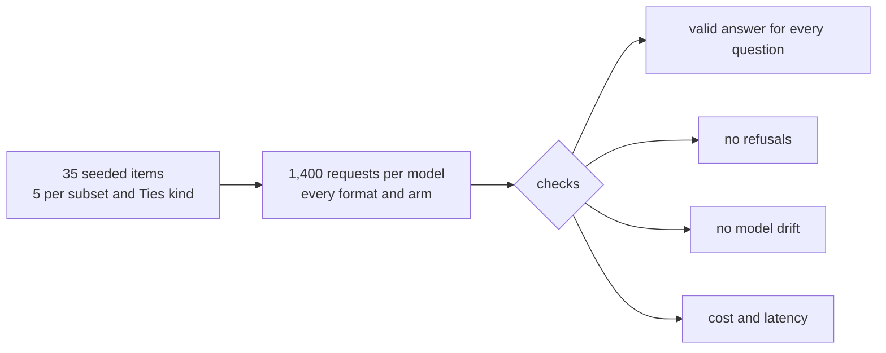

# Pilot run

**Result: the full pipeline worked for all seven model arms.** Every one of the 9,800 planned calls returned a valid typed answer, with no refusals. The pilot checked plumbing, cost and latency only. Its answers were not inspected for position effects and are excluded from the confirmatory analysis.

## Sample

`./order-blind run --run pilot --pilot-per-kind 5 --live` selects 5 items each from Factuality, Precise IF, Math, Focus, Safety, Ties `tied` and Ties `ref` by seeded hash rank (`design.Pilot`). Each item gets every planned request: choice and packed rubric in both ordering arms, solo rubric, two repeats, plus the planted-bias arm for any pilot item that is also a planted item.

## Results

| Model | Calls ok | Invalid answers | Refusals | Response model | Latency p50 / p95 | Cost |
|---|---|---|---|---|---|---|
| Jev 1.13 | 1,400 / 1,400 | 0 | 0 | `jev-1.13.0` | 103 / 142 ms | $0.0975 |
| Jev 1.14 | 1,400 / 1,400 | 0 | 0 | `jev-1.14.0` | 74 / 91 ms | $0.0975 |
| OpenAI Decisions | 1,400 / 1,400 | 0 | 0 | `openai-decisions/gpt-6-luna` | 113 / 193 ms | $0.2058 |
| Clef-flash | 1,400 / 1,400 | 0 | 0 | `clef-flash` | 209 / 306 ms | $0.2109 |
| Microsoft-Decision-1 | 1,400 / 1,400 | 0 | 0 | `microsoft/microsoft-decision-1-20261009` | 304 / 409 ms | $0.0790 |
| SubQ Snap | 1,400 / 1,400 | 0 | 0 | `subq-snap-preview` | 241 / 500 ms | $0.1005 |
| [Rune](https://fireworks.ai/models/fireworks/rune) (Fireworks System One, `accounts/fireworks/routers/rune`) | 1,400 / 1,400 | 0 | 0 | `accounts/fireworks/routers/rune` | 77 / 95 ms | $0.0897 |

- **Validity.** "Valid" means the response answered exactly the planned questions: a choice among the four codes, or a score between levels 0 and 9.
- **Latency.** Measured HTTP round trips at 4 concurrent requests per model, not intrinsic model speed.
- **Cost.** Reported input tokens × published list rate; accounting estimates, not invoices.
- **Retries.** One Microsoft request was rate-limited and succeeded on retry. All SubQ, Jev 1.14 and Rune calls succeeded on the first attempt.
