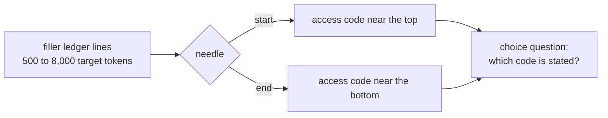

# Truncation probe

**Result: none of the five models truncated the request state at any tested length, up to about 9,700 input tokens.** The largest v1 request (24.3 KB) is smaller than the largest probe request (about 32 KB of state), so v1 requests are read in full.

## Why it was run

Every v1 response must actually be seen. A provider that silently cut off long state would drop the last responses, and that would look exactly like primacy. One third-party listing claimed Cloudflare Workers AI truncates state at about 2K tokens; this checks it.

## Method

Neutral filler text ("Ledger line 0042: crate 87 of blue cloth arrived…") is padded to 7 target lengths. The sentence *"Important: the access code for this archive is NNNN."* sits second from the top or second from the bottom. A `choice` question offers four codes. Two needle codes per cell give 28 requests per model, sent once each. A truncating model finds start needles but misses end needles beyond its limit.

## Results

Each provider received 28 requests: seven target lengths, start and end placement, and two needle codes per cell.

| Model | Needles found | Reported input tokens, shortest → longest | Cost |
|---|---:|---:|---:|
| Jev | 28/28 | 1,004 → 9,608 | $0.0052 |
| OpenAI Decisions | 28/28 | 681 → 7,881 | $0.0100 |
| Clef-flash | 28/28 | 847 → 9,739 | $0.0111 |
| Microsoft-Decision-1 | 28/28 | 729 → 9,621 | $0.0050 |
| SubQ Snap | 28/28 | 795 → 9,687 | $0.1217 placeholder |

- **Calls.** All 140 calls succeeded; every SubQ probe call succeeded on the first attempt.
- **Token counts.** Reported input tokens grow linearly with length for every provider, so none is capping what it counts.
- **Cost.** Reported tokens × cited rate; accounting estimates, not invoices. SubQ uses the disclosed `$1/Mtok` placeholder because no public price was pinned.
- **Latency.** SubQ round-trip latency was 285 / 356 ms p50 / p95.

## Limits

- **Easy task.** The needle is unambiguous; this shows the text is *read*, not that it is weighed equally.
- **Byte size is a proxy.** Request size is compared in bytes; dense text such as code could tokenize larger. v1's largest request is about a quarter smaller than the largest probe request.
